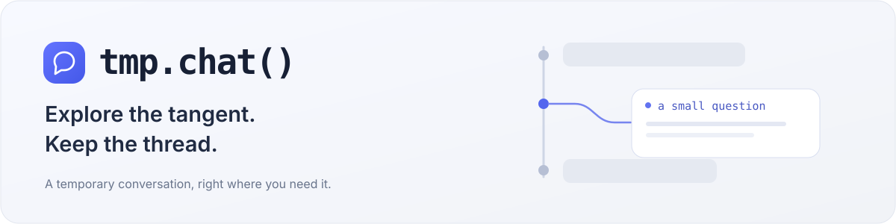
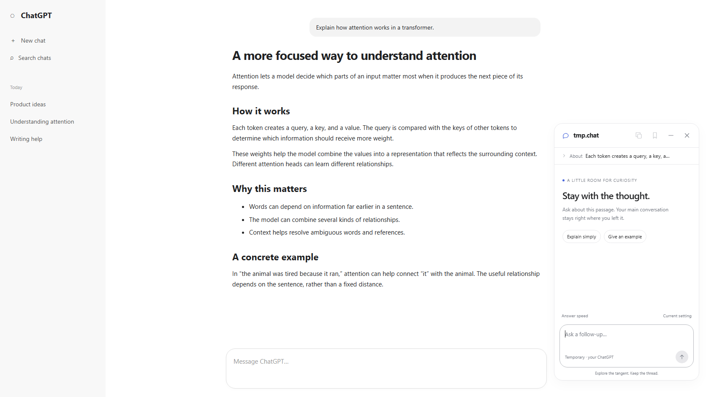
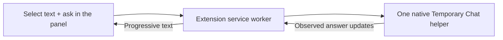

<p align="center">
  
</p>

<p align="center">
  <strong>A temporary conversation, right where your curiosity starts.</strong><br>
  Highlight a passage in ChatGPT. Ask a side question. Keep your original thread.
</p>

<p align="center">
  <a href="#install">Install</a> ·
  <a href="#the-experience">The experience</a> ·
  <a href="docs/ARCHITECTURE.md">Architecture</a> ·
  <a href="PRIVACY.md">Privacy</a> ·
  <a href="docs/DEVELOPMENT.md">Development</a>
</p>

<p align="center">
  <code>Chrome &amp; Edge</code>&nbsp;
  <code>Manifest V3</code>&nbsp;
  <code>No runtime dependencies</code>&nbsp;
  <code>Your ChatGPT account</code>
</p>

---

## A little room for curiosity

A useful explanation rarely leads to just one question. A sentence needs clarifying. A code example deserves a closer look. An unfamiliar term opens a tangent.

Opening another chat means copying context, switching tabs and finding your way back. Asking in the original conversation changes its direction.

**tmp.chat gives that small question its own temporary space.** It adds a contextual side panel to ChatGPT, designed to feel like a natural part of the page rather than another dashboard.

> **Project status:** an experimental, unofficial browser extension. The default branch uses the **v0.1.7 working checkpoint**, with documentation added for this repository. First-question latency and compatibility with future ChatGPT interface changes remain active concerns. This is not an official OpenAI integration or a production-stability guarantee.

## The experience

1. **Select** a passage in one ChatGPT assistant answer.
2. **Choose `tmp.chat()`** beside the selection.
3. **Ask** your question in the side panel.
4. **Explore** follow-ups without adding messages to the original chat.
5. **Minimize, keep or discard** when the tangent has served its purpose.

The main conversation stays in place. The compact horizontal pill lets you put the tangent aside and return to it later.

<p align="center">
  
</p>

<p align="center"><sub>Interface demonstration from a local test fixture, not a personal chat or evidence of current live-service compatibility.</sub></p>

### Small by design

| Feature | What it gives you |
| --- | --- |
| Context from a selected passage | Less copying and re-explaining before asking a small question. |
| A margin panel and compact pill | A side conversation that can get out of the way. |
| Progressive text updates | Answer text is mirrored as the adapter detects it. |
| Readable text and code | Supported formatting, indentation, lists, links and tables. |
| Manual entry | Type a question and optionally paste context if selection is unavailable. |
| One tangent at a time | A clear relationship between the source chat, panel and helper. |
| No separate AI account or API key | Uses the ChatGPT session already in your browser. |

## Install

### Requirements

- Microsoft Edge or Google Chrome with Manifest V3 support. The manifest specifies Chromium 120 or later; website changes can still affect compatibility.
- A signed-in account at [chatgpt.com](https://chatgpt.com).
- Access to this repository. It is private, so viewing or cloning requires authorization.

**Using the extension requires no Node.js, npm install, build step or extension-operated server.** Development tools are optional.

### Load the extension

1. Download this repository with **Code → Download ZIP**, then extract it. Alternatively, clone it:

   ```sh
   git clone https://github.com/Sha1em/tmp.chat.git
   ```

2. Open `edge://extensions` or `chrome://extensions`.
3. Enable **Developer mode**.
4. Select **Load unpacked** and choose the extracted/cloned folder containing `manifest.json`.
5. Open or refresh ChatGPT and sign in normally.
6. Highlight part of an assistant answer and choose **`tmp.chat()`**.

The extension is not published to an extension store. GitHub's source ZIP is different from a generated extension ZIP; both can be extracted and loaded by selecting the folder containing `manifest.json`.

### Updating an existing installation

Keep or copy any useful tangent first. Update the extension files, click **Reload** on its extension card, and **refresh your ChatGPT tabs**. Reloading the extension alone does not replace content scripts in pages that are already open. Start a fresh tangent after updating.

## Everyday controls

| Control | Behaviour |
| --- | --- |
| **Enter** / **Shift+Enter** | Send a question / insert a new line. |
| **Minimize** / **Escape** | Preserve the tangent and collapse it into the horizontal pill. |
| **Toolbar icon** | Open or minimize tmp.chat on a ChatGPT page. |
| **Copy** | Copy the visible side conversation without the hidden context prompt. |
| **Stop** | Ask the helper's native ChatGPT interface to stop generating. |
| **Open / View in ChatGPT** | Inspect the existing helper. Ownership and discard behaviour remain unchanged. |
| **Keep in ChatGPT** | Hand the helper back to you; the extension stops managing that tab. Use ChatGPT's own save action to retain it in history. Keep does not itself confirm a save. |
| **Discard** | After confirmation, close the owned helper and clear the extension's tangent state. |

If selection is unavailable, use the toolbar icon, type a question and optionally use **Add context**. Another ChatGPT tab cannot silently replace an existing tangent.

## Your account, with clear boundaries

tmp.chat opens **one real, inactive helper tab**, verifies native Temporary Chat, and submits through the native composer. That tab remains visible in the browser's tab bar and consumes memory.

Opening the panel prepares the helper while you read and type. **Selected context and your question are inserted only when you press Send.** Follow-ups reuse the same helper conversation without resending the original context.

The extension does not provide a separate free quota, upgrade your model or change account usage limits. **Prefer Instant** optionally attempts a supported native speed control; availability varies and ChatGPT may share that preference across chats.



See the [architecture guide](docs/ARCHITECTURE.md) for components, request flow, streaming and safety checks.

## Privacy, without a second AI service

- No tmp.chat-operated AI server or conversation database.
- No third-party analytics, external fonts or content-tracking endpoint in the extension.
- No API keys, authentication-token extraction or private ChatGPT endpoints.
- Bounded context and transcripts in browser-session storage; the speed preference is stored separately in local extension storage.
- Host access restricted to `https://chatgpt.com/*`.

**ChatGPT receives and processes submitted questions and context through OpenAI's services.** AI inference is not running on your device. Discard clears extension state and closes the helper; it does not promise immediate deletion from OpenAI's systems.

See [PRIVACY.md](PRIVACY.md) for the complete data flow, permissions, retention boundaries and lifecycle.

## What to expect today

| Area | Current boundary |
| --- | --- |
| First answer | A fresh helper can be noticeably slower than follow-ups. A reliable first-response speed improvement has not been established. |
| Website compatibility | Native controls and response markup can change. This is website automation, so updates may be needed. |
| Streaming formatting | Text arrives progressively; structured formatting is reconciled at completion. |
| Rich content | Images, maps and interactive visuals are not reproduced in full. Inspect them in the native helper. |
| Completion | Extraction and completion heuristics have limits; inspect the helper if an answer appears incomplete. |
| Layout | The panel tries to use whitespace, reserve space or collapse. Some live overlap cases still need investigation. |
| Conversation scope | One tangent and one in-flight question. Attachments, voice, native branching and parallel tangents are outside this version. |
| Recovery | Ambiguous sends are observed rather than automatically replayed. Reloaded helpers cannot silently reconstruct conversation proof. |

If something stalls, choose **Open ChatGPT**, inspect sign-in/setup and return to **Check again**. Preserve useful text before discarding. See [troubleshooting](docs/TROUBLESHOOTING.md).

## Checkpoints and experiments

| Version | Role |
| --- | --- |
| **v0.1.7** · `checkpoint-v0.1.7` | Recommended working checkpoint used by this branch. Adds preparation when the panel opens. |
| **v0.1.6** · `stable-v0.1.6` | Earlier recovery checkpoint with verified basic signed-in follow-ups. |
| **v0.1.9** · `fix/hidden-submission-v0.1.9` | Experimental readiness/submission work. No confirmed live speed gain. |

The tags remain unchanged. The default branch adds documentation on top of v0.1.7; it does not incorporate the experimental v0.1.9 runtime. See [CHANGELOG.md](CHANGELOG.md) and [recovery instructions](CHECKPOINT.md).

## For developers

Node.js **22 or later** is sufficient. No dependencies need installing.

```sh
npm run check          # Manifest, runtime syntax and dependency boundaries
npm test              # Unit and regression tests
npm run test:browser  # Real extension with intercepted, offline ChatGPT fixtures
npm run package       # Generate dist/tmp.chat-0.1.7.zip
```

On restricted Windows PowerShell, use `npm.cmd` instead of `npm`.

Fixture tests validate behaviour under controlled conditions. They do **not** establish current signed-in compatibility, response latency or server-side retention.

| Read next | Contents |
| --- | --- |
| [Architecture](docs/ARCHITECTURE.md) | Components, request flow, streaming, limits and safety boundaries. |
| [Development](docs/DEVELOPMENT.md) | Setup, verification, packaging and branch discipline. |
| [Troubleshooting](docs/TROUBLESHOOTING.md) | Connection stages, error codes, recovery and diagnostics. |
| [Technical notes](docs/TECHNICAL_NOTES.md) | Preserved v0.1.7 implementation and historical verification notes. |
| [Contributing](CONTRIBUTING.md) | How to report an issue or propose a focused change. |
| [Privacy](PRIVACY.md) | What is processed, where it is stored and why permissions exist. |

## License and affiliation

A software license has not yet been selected. Access to the source does not by itself grant an open-source license.

tmp.chat is independent and is not affiliated with, endorsed by or maintained by OpenAI. ChatGPT is an OpenAI product. Browser and product names belong to their respective owners.

---

<p align="center"><strong>tmp.chat() — Explore the tangent. Keep the thread.</strong></p>
