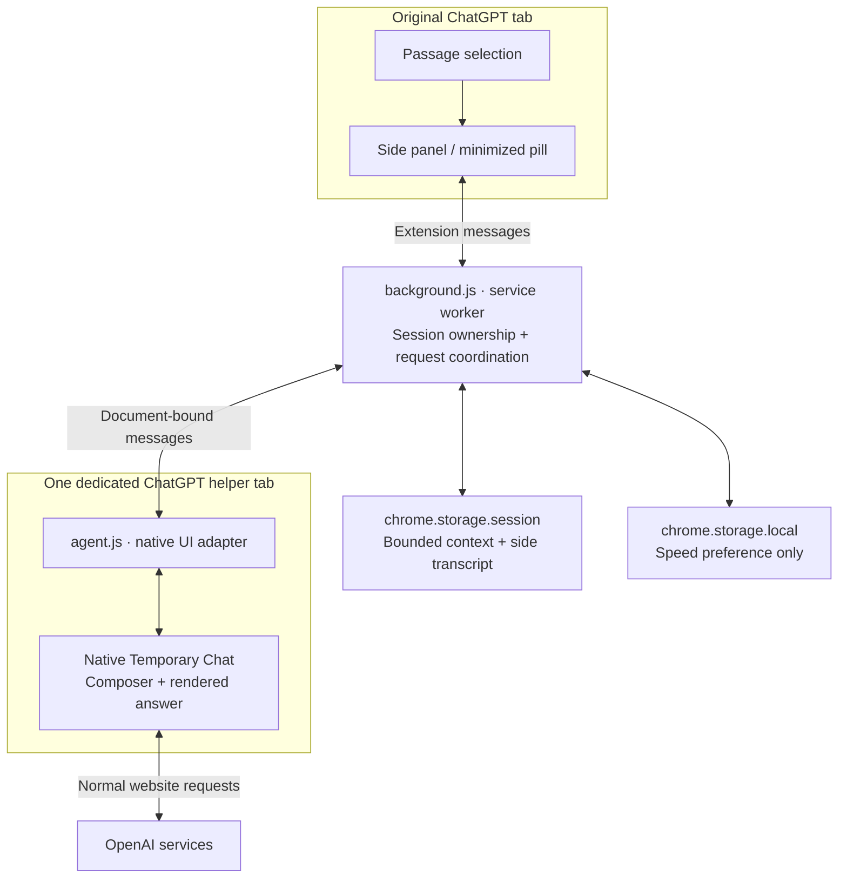
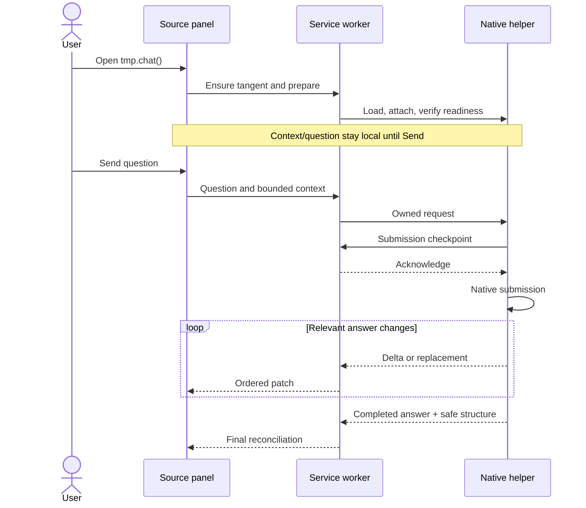

# Architecture

[← Overview](../README.md) · [Development](DEVELOPMENT.md) · [Privacy](../PRIVACY.md)

tmp.chat is a dependency-free Manifest V3 extension. Its own code runs in the browser; ChatGPT's website performs AI requests through the existing signed-in session. This guide describes the **v0.1.7 runtime** on the default branch. Experimental branches can differ.

## Three cooperating surfaces



The source owns interaction; the helper operates native ChatGPT. The worker coordinates them so unrelated source tabs cannot compete for one conversation. No private ChatGPT endpoint or authentication-token extraction is part of the design.

## File map

| File | Responsibility |
| --- | --- |
| [`manifest.json`](../manifest.json) | Manifest V3, worker, source injection and restricted permissions. |
| [`content.js`](../content.js) | Selection action, panel/pill, drafts, controls, theme and active-answer updates. |
| [`background.js`](../background.js) | Single-session ownership, helper preparation, routing, persistence, cleanup and recovery. |
| [`agent.js`](../agent.js) | Native readiness, Temporary verification, composer insertion, continuity, Send/Stop and answer observation. |
| [`lib/core.js`](../lib/core.js) | Bounds, prompt construction, delta checks, formatting allowlist and transcripts. |
| [`lib/selection.js`](../lib/selection.js) | Bounded assistant-passage detection across supported native structures. |
| [`lib/answer.js`](../lib/answer.js) | Ordered text, static code and supported formatting extraction. |
| [`lib/layout.js`](../lib/layout.js) | Collisions, available margin and reservation/collapse decisions. |
| [`icons/`](../icons) | Bundled icons, without an external icon service. |
| [`tests/`](../tests) | Unit tests, deterministic browser fixtures and regressions. |
| [`scripts/`](../scripts) | Source checks, browser suites, asset generation and packaging. |

## First-question lifecycle

1. **Selection or manual opening.** Accept a passage from one supported assistant response, or use manual entry.
2. **Ownership.** Create/restore one tangent owned by the source tab. Another source cannot silently replace it.
3. **Preparation.** Deliberate panel opening prepares one inactive helper. Highlighting alone and passive page loading do not. Immediate Send joins the same preparation job.
4. **Attachment.** Wait for the intended committed ChatGPT document and attach the adapter without requiring every page resource to finish.
5. **Readiness.** Check composer, native gates and Temporary Chat. Personalization choices remain user decisions.
6. **Explicit submission.** Insert context and question only on Send. An opted-in Instant preference may attempt a recognized native composer control.
7. **Checkpoint and click.** Coordinate the submission checkpoint with the worker and use the native Send control once.
8. **Observation.** Detect the resulting conversation and progressively forward extractable answer text.
9. **Completion.** Reconcile supported final formatting, flush state and clean up request-only watchers.



This is the intended successful path, not a complete state machine. Setup, cancellation and errors can pause it. A native click alone does not prove server acceptance.

## Streaming and rendering

The helper uses DOM mutation observation rather than perpetual scraping. It caches a verified active response and rediscovers it when supported structural changes require that. First available text bypasses the ordinary update timer. Later meaningful changes use a target coalescing interval of **120 ms**.

Extraction preserves order and code whitespace. Updates append text or replace an answer when native output is rewritten. Sequence numbers and offsets detect duplicate/missing deltas and allow existing-output resynchronization without resending a question.

The panel updates the active text node rather than rebuilding the conversation on each patch. At completion it applies a bounded, allowlisted formatting tree. Code can therefore appear as plain text during streaming before the final formatted block.

Native executable components, editor engines, Run controls, images and interactive diagrams are not transplanted into the panel. Unsupported content has a native-view fallback. Snapshot/completion heuristics still have limits and can require updates when the website changes.

## Conversation identity and send safety

Temporary Chat and continuity are separate checks: a Temporary label alone does not establish that a page is the conversation used for the previous question.

The helper retains document-local proof using supported routes, native identity evidence and bounded message anchors. The initial owned answer can establish its canonical route under the existing checks. Follow-ups must corroborate the proof; a reloaded adapter cannot invent it.

Checks repeat after asynchronous setup and before submission. Contradictory identity, explicit non-temporary state or insufficient evidence block sending. Native identity values stay local and are not copied into diagnostics.

**Check again observes uncertain existing attempts.** Only positively reported failures before submission can be explicitly retried. Duplicate-send protection is a design constraint.

## Bounds and resource choices

| Item | Bound / policy |
| --- | --- |
| Selected passage | 2,400 characters |
| Nearby context | 4,200 characters |
| Original user question as context | 1,600 characters |
| A new question | 4,000 characters |
| One mirrored answer | 64,000 characters |
| Tangent length | 30 question/answer turns |
| Existing transcript threshold before another turn | 240,000 characters |
| Concurrent helpers / in-flight questions | One / one |
| Unused, verified-empty helper | Eligible for cleanup after approximately three minutes |

Only the initial question sends the original context. A shared preparation promise avoids duplicate helpers. The owned helper is protected from automatic discarding; that does not exempt it from all browser throttling or freezing.

Request heartbeats/watchdogs run when needed. Empty-helper expiry is a separate one-shot alarm: drafts, messages, changed routes, active helpers or uncertain state prevent automatic cleanup.

Loading another ChatGPT page has a real memory/startup cost. A small extension bundle does not make that native page inexpensive.

## Storage and lifecycle

- **`chrome.storage.session`:** bounded context, transcript and coordination state across worker suspension.
- **`chrome.storage.local`:** the content-free speed preference.
- **Helper memory:** continuity proof and response-observation state.
- **No extension server/database:** no second hosted AI service or transcript store.

Minimize preserves the tangent. Discard closes the owned helper and clears extension state. Keep transfers the tab back to the user; native saving remains separate. Source closure/navigation is intended to clean up owned resources. Lost ownership after tabs close remains an edge case to test, not a universal cleanup guarantee.

Browser cleanup does not specify OpenAI's server-side retention. See [PRIVACY.md](../PRIVACY.md).

## First-answer latency

```text
Panel Send
  + remaining helper startup/setup
  + composer readiness and submission
  + native response/frontend scheduling
  + answer discovery/extraction
  + extension forwarding and panel update
```

Preparation overlaps startup with reading/typing. Mutation-driven delivery reduces extension waits after relevant DOM changes. Neither controls server latency, model reasoning or native visibility scheduling.

Manual observations suggest visibility-sensitive first-response behaviour, but do not establish one confirmed cause. Offline fixture timings are not ChatGPT benchmarks. See [STARTUP-v0.1.7.md](../STARTUP-v0.1.7.md) for the controlled startup experiment and its limits.
